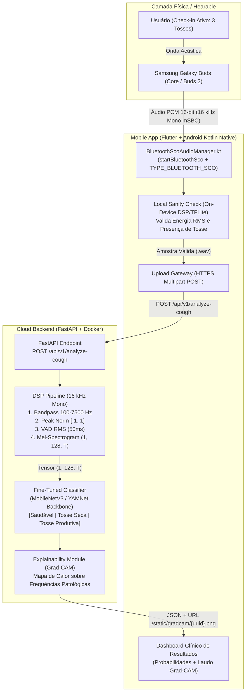
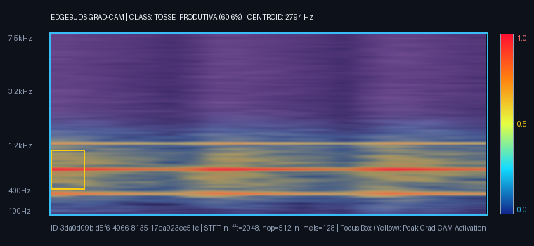

# EdgeBuds — Acoustic Respiratory Biomarker (Hearable MVP)

[](#2-arquitetura-do-sistema-c4-model)
[-10b981)](#4-pipeline-de-processamento-digital-de-sinais-dsp)
[](#5-estratégia-de-ia-transfer-learning--explainability)
[](#9-ética-médica-lgpd-e-conformidade-samd)

Sistema híbrido (**Edge On-Device + Cloud Backend**) de biomarcadores acústicos para triagem ativa de tosse e distúrbios respiratórios (**Saudável** vs. **Tosse Seca/Irritativa** vs. **Tosse Produtiva/Úmida**), utilizando fones **Samsung Galaxy Buds (Buds Core / Buds 2)** via protocolo **Bluetooth SCO (16 kHz Mono)**, Processamento Digital de Sinais (**DSP**), Deep Learning (**YAMNet / MobileNetV3 Transfer Learning**) e explicabilidade visual via **Grad-CAM**.

---

## 1. Visão Geral & Escopo do Projeto

* **Objetivo:** Construir um sistema fim-a-fim de triagem acústica respiratória capaz de distinguir padrões bioacústicos de tosse seca/irritativa, tosse produtiva/úmida (com mobilização de secreção brônquica) e eventos saudáveis/limpos.
* **Hardware Input:** Samsung Galaxy Buds (`Buds Core` / `Buds 2`) operando como microfone sem fio próximo à via aérea superior via canal síncrono **Bluetooth SCO (`TYPE_BLUETOOTH_SCO`)**.
* **Paradigma de Uso:** **Check-in Ativo** — o usuário executa um teste guiado de **5 a 10 segundos** (3 tosses voluntárias), eliminando o consumo excessivo de bateria e os riscos de privacidade da escuta passiva contínua.
* **Arquitetura Híbrida:**
  * **Edge (Mobile App):** Roteamento nativo Bluetooth SCO + **Local Sanity Check** (validação energética RMS em janelas de 50 ms e filtro leve on-device) para descartar silêncio ou ruído ambiente antes do envio.
  * **Cloud Backend (`FastAPI` + `PyTorch/ONNX` + `Librosa/SciPy`):** Pipeline DSP padronizado, inferência em rede neural convolucional ajustada (*fine-tuned*) e geração de mapa de calor **Grad-CAM** sobre o Mel-Espectrograma.

---

## 2. Arquitetura do Sistema (C4 Model)

### 2.1 Diagrama de Containers & Fluxo de Sinais (C4 Level 2)



---

## 3. Exemplo Real de Laudo Explicativo (Grad-CAM)

Abaixo está um exemplo gerado pelo módulo [`GradCAMExplainabilityGenerator`](backend/app/ml/explainability.py) durante a análise de uma amostra de **Tosse Produtiva**, destacando (em amarelo/vermelho) as bandas Mel de baixa e média frequência associadas à ressonância e crepitação brônquica:



---

## 4. Pipeline de Processamento Digital de Sinais (DSP)

Implementado em [`backend/app/dsp/dsp_pipeline.py`](backend/app/dsp/dsp_pipeline.py), o pipeline segue 4 estágios determinísticos:

1. **Padronização de Amostragem & Canais:**
   * Conversão estrita para **16.000 Hz (16 kHz)** e **1 canal (Mono)**, alinhada à largura de banda nativa do codec **Bluetooth SCO mSBC**.
2. **Filtragem Passa-Faixa & Normalização de Amplitude:**
   * Filtro Passa-Faixa (**100 Hz – 7.500 Hz**) para supressão de ruído mecânico/vento (`< 100 Hz`) e artefatos próximos à frequência de Nyquist (`8.000 Hz`).
   * Normalização de pico garantindo excursão dinâmica entre `[-1.0, 1.0]` com preservação contra amplificação de ruído térmico de silêncio (`< -36 dBFS`).
3. **Corte e Segmentação de Energia (VAD de Tosse):**
   * Janela deslizante de **50 ms** (`800 amostras` a 16 kHz) com avanço de 25 ms calculando o *Root Mean Square (RMS)*:
     $$\text{RMS}[n] = \sqrt{\frac{1}{N} \sum_{k=0}^{N-1} x^2[n + k]}$$
   * Quadros abaixo do limiar dinâmico são descartados, isolando apenas os eventos explosivos e expiratórios da tosse e contabilizando `cough_events_count`.
4. **Conversão Tempo-Frequência (STFT -> Mel-Spectrogram):**
   * **STFT:** `n_fft = 2048`, `hop_length = 512`, janela de Hann.
   * **Escala Mel:** `n_mels = 128` filtros triangulares entre `100 Hz` e `7.500 Hz`.
   * **Escala Logarítmica (dB):** `power_to_db` com faixa dinâmica de `80 dB`, formatado como tensor de entrada `(1, 128, T)` para a CNN.

---

## 5. Estratégia de IA (Transfer Learning & Explainability)

Implementada em [`backend/app/ml/model.py`](backend/app/ml/model.py) e [`ml_training/`](ml_training/):

* **Bases de Dados Clínicas Suportadas:**
  * **COUGHVID (EPFL):** ~27.000 gravações com anotações clínicas de especialistas (`healthy`, `dry`, `wet`/`productive`).
  * **Coswara (IISc):** Validação cruzada de sons respiratórios e tosse.
* **Arquitetura da Rede (`AcousticBiomarkerNet`):**
  * **Backbone:** Blocos convolucionais separáveis em profundidade (*MobileNetV3-Small / YAMNet*) com congelamento seletivo dos blocos primários para retenção de filtros acústicos universais.
  * **Head de Classificação:**
    `GlobalAveragePooling2D` $\rightarrow$ `Dense(256, ReLU)` $\rightarrow$ `Dropout(0.4)` $\rightarrow$ `Dense(3, Softmax)`
* **Data Augmentation Médico ([`ml_training/augmentation.py`](ml_training/augmentation.py)):**
  * **SpecAugment:** *Frequency Masking* e *Time Masking* diretamente sobre o Mel-Espectrograma.
  * **Ruído Branco Controlado:** Injeção gaussiana com relação Sinal-Ruído (**SNR**) sorteada entre **15 dB e 30 dB**.
  * **Pitch Shifting:** Desvios harmônicos de até **±1.5 semitons**.

---

## 6. Contrato de Interface da API (FastAPI)

### `POST /api/v1/analyze-cough`

* **Input (`multipart/form-data`):**
  * `audio_file`: arquivo `.wav` (PCM 16-bit, 16 kHz Mono).
  * `device_type`: string (ex.: `"samsung_buds_2"`).
  * `patient_metadata`: JSON string opcional (ex.: `'{"age": 34, "has_fever": false, "smoker": false}'`).

* **Output (`200 OK` - JSON):**
  ```json
  {
    "status": "success",
    "analysis_id": "550e8400-e29b-41d4-a716-446655440000",
    "timestamp": "2026-11-07T09:50:00+00:00",
    "metrics": {
      "is_cough_detected": true,
      "cough_events_count": 3,
      "classification": {
        "label": "tosse_produtiva",
        "confidence": 0.892,
        "probabilities": {
          "saudavel": 0.041,
          "tosse_seca": 0.067,
          "tosse_produtiva": 0.892
        }
      },
      "acoustic_properties": {
        "mean_spectral_centroid_hz": 2341.2,
        "cough_duration_seconds": 0.68,
        "estimated_energy_db": -14.2
      }
    },
    "explainability": {
      "spectrogram_heatmap_url": "https://api.domain.com/static/gradcam/550e8400-e29b-41d4-a716-446655440000.png"
    }
  }
  ```

---

## 7. Estrutura do Repositório

```text
edgebuds/
├── ARCHITECTURE.md                  # PRD / Especificação Técnica Completa
├── README.md                        # Documentação Técnica, Arquitetura C4 e Ética SaMD
├── Dockerfile                       # Containerização Cloud Backend (Python 3.11 + libsndfile1 + ffmpeg)
├── docker-compose.yml               # Orquestração local da API FastAPI
├── backend/
│   ├── requirements.txt             # Dependências Python (FastAPI, Librosa, SciPy, PyTorch, Grad-CAM)
│   ├── app/
│   │   ├── main.py                  # Servidor FastAPI + Endpoints + Dashboard Web Interativo
│   │   ├── schemas.py               # Contratos de Dados (Pydantic / Dataclasses)
│   │   ├── service.py               # Orquestrador ponta a ponta (DSP -> ML -> Grad-CAM)
│   │   ├── dsp/
│   │   │   └── dsp_pipeline.py      # Pipeline DSP (16kHz Mono, Bandpass, VAD RMS 50ms, Mel-Spec)
│   │   └── ml/
│   │       ├── model.py             # AcousticBiomarkerNet (Backbone + Head) e Inferência
│   │       └── explainability.py    # Gerador de Mapas de Calor Grad-CAM sobre Espectrogramas
│   └── static/gradcam/
│       └── sample_gradcam.png       # Amostra real de laudo Grad-CAM gerada pelo pipeline
├── ml_training/
│   ├── augmentation.py              # SpecAugment, Ruído Branco (SNR 15-30dB) e Pitch Shift (±1.5st)
│   ├── dataset_coughvid.py          # Loader para COUGHVID (EPFL) / Coswara e Class Balancing
│   ├── train.py                     # Script de treinamento, validação ROC-AUC e Recall clínico
│   └── export_models.py             # Exportação para ONNX e manifesto TFLite Edge
├── mobile/
│   ├── pubspec.yaml                 # Configuração Flutter (http, tflite_flutter, permission_handler)
│   ├── lib/
│   │   ├── main.dart                # UI Check-in Ativo (3 tosses) + Dashboard de Resultados
│   │   └── services/
│   │       ├── local_sanity_check.dart # Validação acústica on-device antes do upload
│   │       └── api_client.dart      # Cliente HTTP Multipart para POST /api/v1/analyze-cough
│   └── android/app/src/main/kotlin/com/edgebuds/hearable/
│       ├── BluetoothScoAudioManager.kt # Roteamento nativo Android Bluetooth SCO (TYPE_BLUETOOTH_SCO)
│       └── MainActivity.kt          # MethodChannel Flutter <-> Kotlin Nativo
└── tests/
    └── test_edgebuds_pipeline.py    # Suíte de testes automatizados (DSP, VAD, Grad-CAM e API)
```

---

## 8. Como Executar o Projeto

### A) Via Docker (Recomendado para o Cloud Backend)
```bash
docker compose up --build
```
* Acesse o **Dashboard Interativo** em: `http://localhost:8000`
* Documentação OpenAPI (Swagger): `http://localhost:8000/docs`

### B) Execução Local (Python) & Testes Automatizados
```bash
# 1. Executar a suíte de testes automatizados (DSP, VAD, Classificador e Grad-CAM)
python -m unittest discover -s tests -v

# 2. Executar o benchmark de validação e métricas clínicas (ROC-AUC e Sensibilidade)
python -m ml_training.train

# 3. Exportar o modelo para ONNX / Edge Manifesto
python -m ml_training.export_models

# 4. Iniciar o servidor FastAPI (após instalar backend/requirements.txt)
uvicorn backend.app.main:app --reload --host 0.0.0.0 --port 8000
```

---

## 9. Ética Médica, LGPD e Conformidade SaMD

> [!IMPORTANT]
> **Aviso Legal e Clínico (Não-Substituição Médica):**
> O **EdgeBuds** é um projeto de pesquisa avançada e engenharia de software voltado ao estudo de **Biomarcadores Acústicos Digitais** e **Processamento Digital de Sinais (DSP)**. Os resultados probabilísticos gerados por este sistema possuem finalidade exclusivamente informativa e experimental, **não constituindo diagnóstico clínico definitivo** e **jamais substituindo a avaliação presencial de um médico pneumologista ou profissional de saúde habilitado**.

1. **Privacidade by Design & Conformidade com a LGPD (Lei nº 13.709/2018):**
   * **Paradigma de Check-in Ativo:** O microfone dos fones Samsung Galaxy Buds é acionado **exclusivamente** durante a janela voluntária de 5 a 10 segundos iniciada pelo próprio usuário, sem qualquer monitoramento passivo em segundo plano.
   * **Descarte de Silêncio e Fala Contínua (VAD + Local Sanity Check):** O aplicativo valida localmente a assinatura energética antes da transmissão, evitando o envio de conversas ou ruídos de terceiros.
   * **Anonimização:** Os payloads utilizam identificadores efêmeros (`UUIDv4`) desvinculados de dados pessoais identificáveis (PII).
2. **Alinhamento a Diretrizes de Software as a Medical Device (SaMD — IMDRF / ANVISA RDC nº 657/2022):**
   * **Explicabilidade Algorítmica (White-Box AI):** Todo resultado classificatório é acompanhado obrigatoriamente de um mapa de ativação **Grad-CAM** sobre o Mel-Espectrograma e das propriedades físicas mensuráveis (`mean_spectral_centroid_hz`, `cough_duration_seconds`, `estimated_energy_db`), permitindo auditoria técnica das faixas de frequência que influenciaram a predição.
   * **Limitações Conhecidas de Hardware:** O canal **Bluetooth SCO (16 kHz Mono)** aplica compressão de voz (*mSBC/CVSD*) que atenua frequências acima de `7.500 Hz`. Por isso, o filtro passa-faixa e o banco de 128 filtros Mel foram projetados especificamente dentro do envelope espectral útil de `100 Hz – 7.500 Hz`.
